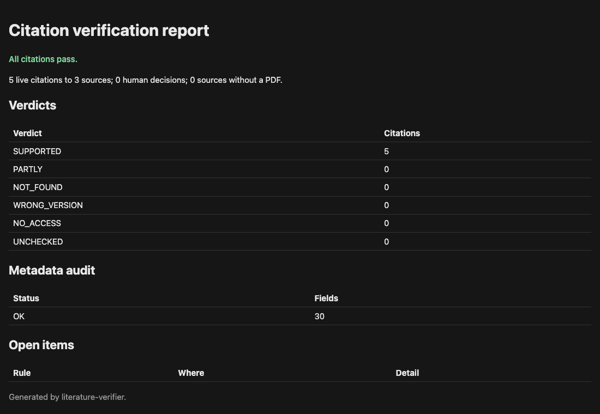
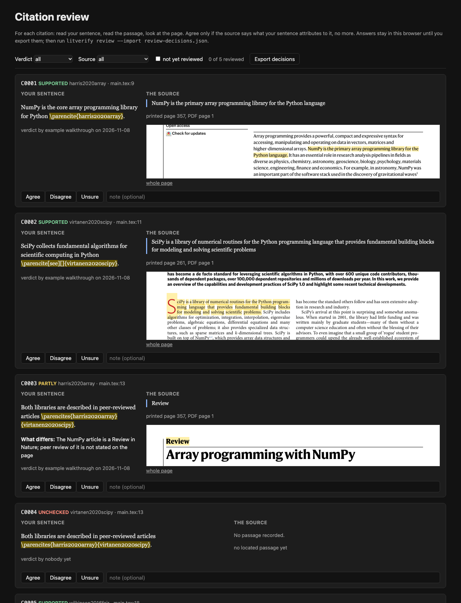
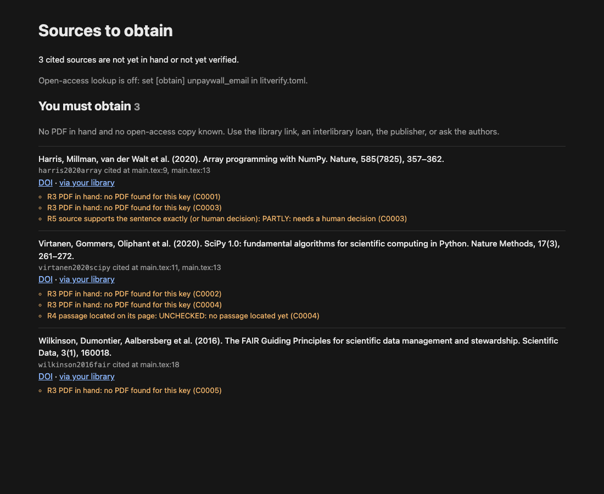

# literature-verifier

**No hallucinated citations.** `literature-verifier` (CLI: `litverify`) checks a LaTeX
manuscript until every citation in it meets three conditions:

1. **The work is real.** The cited key resolves to a registry record (a DOI in Crossref or
   DataCite), and the bibliography entry matches that record field by field.
2. **The PDF is in hand.** A file of that work exists on your disk.
3. **The passage is located.** Each citation occurrence is mapped to a passage in that PDF,
   with the page as printed and a verbatim excerpt, and the passage supports exactly what
   the sentence attributes to it.

`litverify check` fails the build on any violation, naming the citation, its file and line,
and the rule it breaks. A human makes the final call on every citation that is not fully
supported, and can sign off every citation after seeing the passage on its page.

## Why

Citation errors are old: wrong page, wrong year, a claim the source does not make, a paper
cited for what another paper said about it. Language models add a new failure: a reference
that looks right and does not exist, or a real paper cited from memory for something it
never says. Both pass a LaTeX build and most reviews. They are caught only by someone who
opens the source and finds the sentence.

This tool makes that check systematic and leaves a record of it: one ledger row per citation
with the excerpt and page, versioned next to the manuscript.

## The rules

These are enforced by `litverify check` and repeated in every agent definition.

| Rule | Requirement |
|---|---|
| R1 | The work is real: the key is in the bib and its DOI resolves in Crossref or DataCite. A work without a DOI (many books) passes only with a human decision naming the record that was checked. **Unresolved is fail.** |
| R2 | The metadata matches: title, authors, year, venue, volume, issue, pages, DOI, type. Every mismatch is fixed in the reference manager or carries a human decision. |
| R3 | The PDF is in hand. |
| R4 | **No verdict without a located passage**: printed page, PDF page and verbatim excerpt, and the excerpt is found on that page of the PDF. `check` re-reads the PDF every time. |
| R5 | The source supports exactly what the sentence says: SUPPORTED, or a human decision on PARTLY / WRONG_VERSION / NOT_FOUND / NO_ACCESS. **The human decides every PARTLY.** |
| R6 | **A reworded sentence may only narrow the claim, never strengthen it.** Any sentence edited after it was checked must be verified again. |
| R7 | The ledger lists every citation in the sources. |
| R8 | The author has looked: a citation the author marked "disagree" in the review page always fails; `check --require-human` requires a current "agree" on every citation. |

And one rule no program can enforce, so the agent definitions state it in every file:
**no source from model memory.** An agent may not add, keep or "fix" a citation from what it
remembers about a paper. R3 and R4 make that rule checkable: a citation passes only with the
file in hand and the passage found in it.

## Quickstart

Requires Python 3.11+. Page images on the review page need poppler (`pdftoppm`,
`pdftotext`; `brew install poppler`, `apt install poppler-utils`).

```bash
uv pip install "literature-verifier @ git+https://github.com/jakoraner/literature-verifier"
cd my-thesis
cat > litverify.toml <<'EOF'
tex = ["chapters/*.tex", "main.tex"]
bib = "references.bib"
pdf_dirs = ["pdfs"]
EOF

litverify sync      # ledger: one row per citation occurrence -> citations.csv
litverify meta      # bib vs Crossref/DataCite -> metadata.csv
litverify pdfs      # which cited works have a PDF
litverify obtain    # what you still need, with DOI, open-access and library links
litverify check     # fails, listing every citation and the rule it breaks
```

Verify a citation by recording the passage. The command refuses unless the excerpt is on
that page of the PDF:

```bash
litverify locate --key harris2020array --excerpt "primary array programming library"
litverify record C0001 --verdict SUPPORTED --by "me" --page 357 \
    --excerpt "NumPy is the primary array programming library for the Python language"
litverify record C0003 --verdict PARTLY --by "me" --page 357 --excerpt "..." \
    --what-differs "the source says X for adults only"
litverify decide C0003 "narrowed the sentence to adults"     # human only
litverify review    # page to check every citation by eye; --import the answers
litverify report    # report.md / report.html; --json for agents
```



Commit `citations.csv`, `metadata.csv` and `litverify.toml`. Never commit the PDFs.

### In CI

CI usually has no PDFs (copyright). `litverify check --ledger-only` trusts the PDF paths
and located excerpts recorded in the committed ledger instead of re-reading the files. It
still fails on everything else (missing rows, unchecked or stale citations, missing
decisions, metadata). Run the full `litverify check` locally before you submit.

## The ledger

`citations.csv`, one row per citation occurrence (one key in one citation command):

| Columns | Written by |
|---|---|
| `cid`, `key`, `file`, `line`, `command`, `prenote`, `postnote`, `sentence`, `anchor`, `pdf`, `status` | `sync`, from the .tex sources |
| `page` (as printed), `pdf_page` (index), `excerpt`, `located` (`text` or `scan`), `verdict`, `what_differs`, `checked_sentence`, `checked_by`, `checked_at` | `record`, which refuses an unlocated passage |
| `decision`, `decided_at`, `human_checked`, `human_note` | the human (`decide`, `review --import`) |

Rows are anchored by a hash of the key and the citing sentence, not the line number, so
edits elsewhere move a row without breaking it. A reworded sentence (similarity >= 0.75)
keeps its row and becomes stale until re-verified; a rewritten one gets a new row. Rows
whose citation disappears are kept as `removed` and revived if it returns. All the `\cite`
variants of LaTeX, natbib and biblatex are recognised, including pre- and postnotes,
multicite commands (`\cites[3]{a}[5]{b}`) and citations spanning lines; `\nocite` and
comments are ignored.

## The review page: seeing it with your own eyes

`litverify review` writes `litverify-report/review/index.html`, one card per citation:
your sentence with the citation marked, the excerpt with printed and PDF page, an image of
that PDF page cropped to the passage with its words highlighted, the verdict and who gave
it. You answer Agree, Disagree or Unsure, with a note. Answers stay in the browser until
you export them; `litverify review --import review-decisions.json` writes them to the
ledger. A sign-off lapses when the sentence, verdict, page or excerpt changes. The page
works offline, without external assets, and follows the system light or dark setting;
images are PNG files next to the HTML.

This is the step no agent can do for you: reading the sentence you wrote beside the
passage it rests on, and deciding that the meaning matches.



## Getting the sources: `litverify obtain`

`obtain.html` lists every cited source not yet in hand or not yet verified, grouped by who
acts: **you must obtain** (no PDF, no free copy), **open-access copy found** (`obtain
--download` saves direct PDF links), **in hand, verification open**. Each entry has the full
reference, where it is cited, the DOI link, the open-access link and a link through your own
library. Library links come from a template you set, for an OpenURL resolver, EZproxy,
OpenAthens or a discovery search: see [docs/library-links.md](docs/library-links.md).
Open-access lookup uses Unpaywall and runs only if you set your own contact e-mail.



## Zotero and Better BibTeX

The tool reads any BibTeX file, but it is built around Zotero with the Better BibTeX
plugin, which avoids the usual failures of a hand-kept `.bib`:

- **Stable citation keys.** Better BibTeX generates keys from a formula you set (author,
  year, short title) and can pin them, so `\cite{harris2020array}` keeps working when the
  item is edited.
- **Auto-export.** Export a collection as Better BibTeX with "Keep updated", and the `.bib`
  in your project is rewritten on every change in Zotero. You never edit the file by hand,
  so there is one place to fix an entry.
- **DOI-based import.** Adding an item by DOI (the magic wand, or the browser connector on
  the publisher page) fills the fields from the registry record, which is what `meta`
  compares against. Typing references by hand, or pasting them from a chatbot, is where
  wrong authors and non-existent titles come from.
- **PDF storage.** Zotero stores the PDF with the item. `litverify` finds it through
  Zotero's local API (Zotero 7: Settings, Advanced, "Allow other applications on this
  computer to communicate with Zotero"; then `[zotero] local_api = true` in
  `litverify.toml`), or through the `file` field if you export it, or in a folder of
  `<citekey>.pdf` files.
- **The Zotero item is the single place to fix metadata.** When `meta` reports a FIX, correct
  the item in Zotero; the auto-export carries it into the `.bib`; re-run `meta`.

PDF lookup order: `pdf_dirs` (`<key>.pdf` or `Anything [<key>].pdf`), the bib `file` field,
then Zotero's local API (stored files, linked files and links to `file://` URLs).

## The agentic layer

`.claude/` holds definitions for [Claude Code](https://claude.com/claude-code):

- `agents/litverify-scout.md` finds the real record and a legal PDF for unresolved or
  missing sources and reports Zotero corrections. It never edits the bib and never
  substitutes a "similar" paper.
- `agents/litverify-verifier.md` locates, in the PDF, the passage each assigned citation
  rests on (rendering image-only pages and reading them as images) and records it with
  `litverify record`, which refuses anything it cannot find on the page.
- `agents/litverify-adversary.md` re-checks verdicts blind to the recorded excerpt, reads the
  surrounding section for context, and reports disagreements. It never writes the ledger.
- `skills/verify-citations/SKILL.md` runs the rounds: (0) state; (1) metadata and sources;
  (2) independent context checks split across parallel verifiers, batched by source; (3)
  adversarial re-check, with disagreements re-verified and the stricter verdict kept;
  repeat until only human items remain; then the human review page and a decision on every
  PARTLY. Done when `litverify check --require-human` passes.

The CLI is the enforcement; the agents are labour. An agent cannot record a verdict the
tool cannot locate, and the agent definitions forbid it to decide anything that belongs to
the human. Parallel agents are safe: every write to the ledger is locked.

Copy `.claude/` into your project to use them.

## Case study: the book Claude could cite but nobody had read

In the MSc thesis this tool was built for, an AI agent had cited Holmqvist et al. (2011),
*Eye Tracking: A Comprehensive Guide to Methods and Measures* (Oxford University Press),
three times. No copy of the book was available to anyone working on the thesis. The
citations were from model memory: the book is a standard reference in the field, so the
model "knew" what it covered.

Verification flagged all three as NO_ACCESS: no PDF, no passage, so no verdict was
possible. The author borrowed the book and scanned the cited chapter. The scan had no text
layer, so the pages were read one by one as images and the passages transcribed
(`record --scan`). Two citations were confirmed at their exact printed pages, in the
section on areas of interest (pp. 206-217). The third cited the book for recording methods,
calibration and event detection, which the scanned chapter does not contain; it was
narrowed to a general pointer to the book, and the chapters that would be needed were
flagged.

Over the whole thesis, the audit covered hundreds of citations. Several dozen were found to
support only part of their sentence, and were narrowed.

## What it does not do

- It does not judge meaning by itself. Whether a passage supports a sentence is decided by
  a person or an agent; the tool enforces that the decision rests on a located passage and
  that a human signs off what is not fully supported.
- Sentence extraction from LaTeX is heuristic (paragraphs, sectioning, sentence-final
  punctuation, common abbreviations). Unusual macros can make a ledger sentence too long
  or too short; the citation is still tracked.
- Text location needs a text layer. Image-only pages are recorded with `--scan` and are
  not re-verified automatically; the review page shows the whole page image for them.
  Excerpt matching ignores whitespace, case, punctuation and diacritics, and joins
  hyphenated line breaks; text in figures, formulas or unusual encodings may not be found.
- Metadata is compared with Crossref and DataCite only. Works without a DOI (many books,
  theses, web pages) are reported as unresolved and need a human decision. URLs other than
  doi.org links are not fetched.
- Highlights on the review page need poppler. Without it, cards show text only.
- Only BibTeX/biblatex citation commands in `.tex` files are scanned (no Markdown, Word or
  Typst).
- The Zotero local-API lookup was tested against mocked responses and, read-only, against
  one Zotero 7 installation; other Zotero versions may differ.

## Development

```bash
uv venv -p 3.11 && uv pip install -e ".[dev]"
pytest
ruff check src tests
```

Tests run on `examples/minimal` with all network calls mocked (Crossref fixtures are
trimmed real records) and generated PDFs.

## Credits and licence

Developed by Jacob Hoffmann for his MSc thesis at the Technical University of Denmark
(DTU), with Claude Code. MIT licence, see [LICENSE](LICENSE).

The screenshots show this tool's own output on `examples/minimal`. The page crops in them
are from open-access articles published under CC BY 4.0: Harris et al. (2020),
*Array programming with NumPy*, Nature 585, doi:10.1038/s41586-020-2649-2; Virtanen et al.
(2020), *SciPy 1.0*, Nature Methods 17, doi:10.1038/s41592-019-0686-2; Wilkinson et al.
(2016), *The FAIR Guiding Principles*, Scientific Data 3, doi:10.1038/sdata.2016.18.
